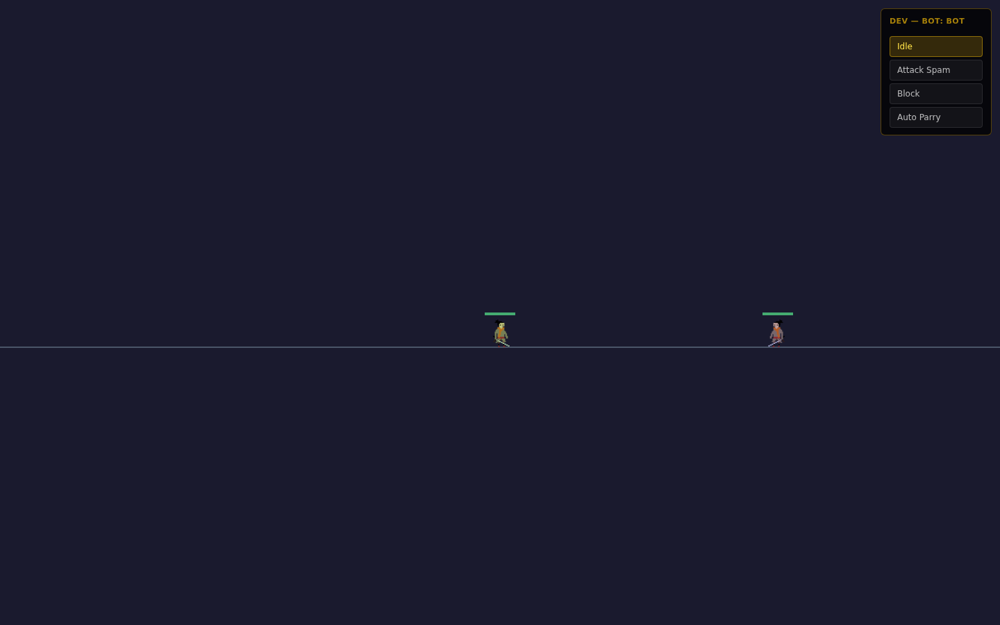
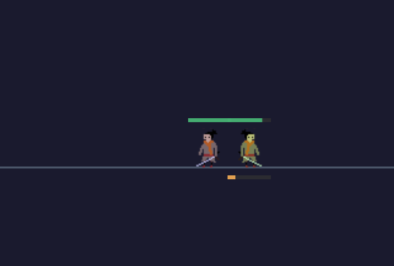

# Riposte

A multiplayer fighting game with a Go server and a Phaser client. The netcode uses an authoritative server, fixed-timestep physics, client-side prediction, server reconciliation, and entity interpolation.

The server owns the simulation, clients predict their own movement and replay unacknowledged inputs on top of server state, and remote players render 80ms in the past using a snapshot buffer.



## Highlights

- **Authoritative server** - all movement, combat, and hit resolution run server-side in Go at ~60 ticks/second.
- **Fixed-timestep physics** - server and client advance physics in the exact same `1/60s` steps through an accumulator, so the client's prediction mirrors the server's simulation step for step.
- **Client prediction and reconciliation** - inputs are sequence-numbered and buffered; on each server snapshot the client discards acknowledged inputs and replays the rest over the authoritative state.
- **Entity interpolation** - remote players render from a timestamped snapshot buffer with an 80ms render delay; the local player gets a decaying visual offset so reconciliation snaps never pop on screen.
- **Server-side combat** - AABB hitbox checks resolve after each physics tick, with blocking, a 100ms parry window that reflects posture damage back at the attacker, a posture meter that staggers on break, and critical damage against staggered players.
- **Scriptable server-side bots** - bots join rooms as players and run inside the same fixed-step loop (`idle`, `attack_spam`, `block`, `auto_parry`), so combat and netcode can be tested without a second client.
- **Custom WebSocket protocol** - a single socket carries typed request/response events and room broadcasts as JSON envelopes.



## Tech stack

| Layer | Tools |
| --- | --- |
| Backend | Go 1.24, Fiber v2, gofiber/websocket |
| Frontend | SvelteKit 2 (Svelte 5), TypeScript, Phaser 3 |
| Rendering/UI | Tailwind CSS 4, bits-ui |
| Monorepo | Turborepo + pnpm workspaces |

## Repository layout

```
apps/
  backend/    Go game server (rooms, physics, combat, bots)
  frontend/   SvelteKit + Phaser client (lobby, game scene, prediction)
```

## How a tick flows

1. The client buffers each input with a sequence number, applies it to the local predicted state immediately, and sends it over the socket.
2. The server's game loop accumulates real elapsed time and steps physics in exact `16.67ms` chunks. Frame time is capped at 100ms so a stall cannot trigger a catch-up spiral.
3. Bot AI runs first inside each fixed step, then player physics (gravity, dashes, cooldowns, timers), then hit resolution across all attackers and defenders.
4. The server broadcasts a snapshot of every player plus the last processed input sequence per player.
5. The client acknowledges inputs up to that sequence, replays the remaining buffer over the server state, and smooths the correction through a decaying visual offset.

## Combat model

All values live in `apps/backend/src/constants/physics.go` and are mirrored by the client.

| Mechanic | Behaviour |
| --- | --- |
| Attack | Locks movement, 200ms swing, 400ms cooldown |
| Block | 30% movement speed, absorbs hits as posture damage |
| Parry | Blocking within 100ms of press deflects and damages the attacker's posture |
| Posture | Breaks at 100, causing a 1.2s stagger |
| Stagger | Defenseless; hits taken while staggered deal 50 HP instead of 20 |
| Dash | Horizontal dash, air dash, and downward plunge on a shared 500ms cooldown |
| Rounds | A death resets both players for the next round |

## Getting started

Prerequisites: Go 1.24+, Node.js, pnpm 9, and [air](https://github.com/air-verse/air) for Go hot reload:

```bash
go install github.com/air-verse/air@latest
```

Then install dependencies and start both apps:

```bash
pnpm install
pnpm dev
```

Turborepo starts the backend on `:5000` (override with `PORT` in `apps/backend/.env`) and the frontend on `http://localhost:5173`, which connects to `ws://localhost:5000/ws`. Open `http://localhost:5173/setup-player` to play (the root path has no page). Use two browser windows to create a room in one and join it from the other, or add a bot from the in-game dev menu.

To run the backend alone:

```bash
cd apps/backend
go build -o build/main src/main.go
./build/main
```

## Protocol sketch

Every message is a JSON envelope with an `event` name and a `payload`. Client events include `create_room`, `join_room`, `start_game`, `move_player`, `add_bot`, and `set_bot_behavior`; the server replies with typed responses and broadcasts `player_joined`, `player_left`, `game_started`, and the per-tick `game_loop` snapshot. See `apps/backend/src/events/events.go` for the full set.
